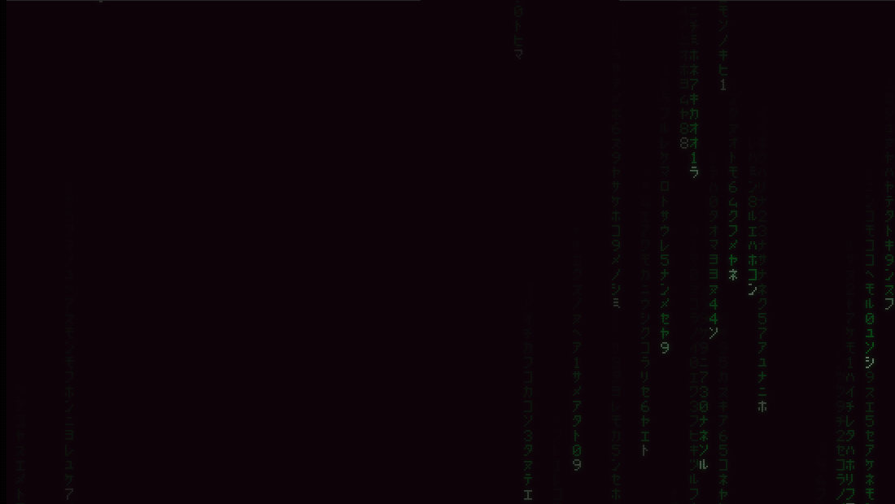
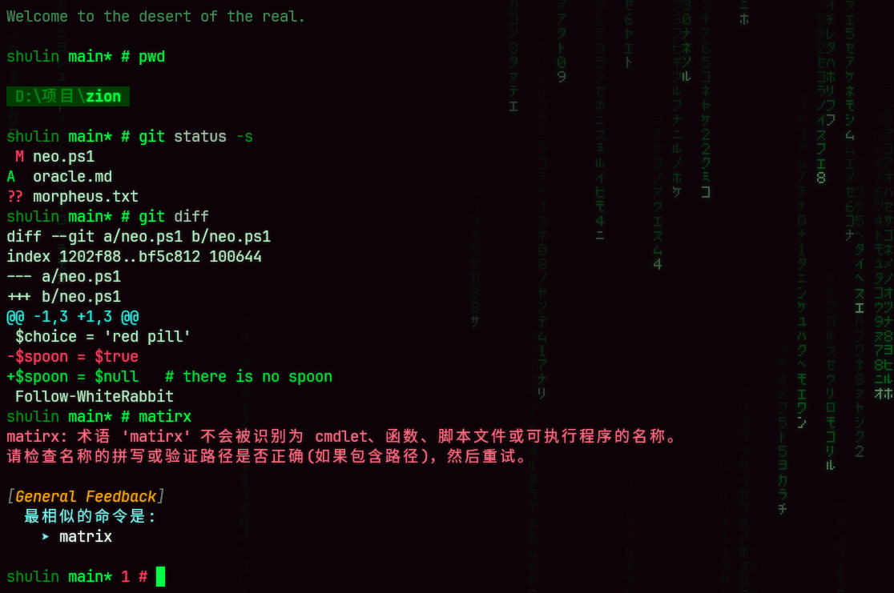

# Matrix Minimal

> Wake up, Neo... The Matrix has you.

一个黑客帝国风格的 PowerShell 主题，搭配 Windows Terminal 使用，提示符基于 [Oh My Posh](https://ohmyposh.dev)。



## 效果

- 提示符：
  
  - 名字、git 分支，最后是 `>`，管理员窗口里换成 `#`。
  
  - 激活了 Python 环境时，名字后面会用括号显示环境名，比如 `shulin (base) main >`。conda、mamba、pixi，以及 venv、uv、poetry、virtualenv 建的环境都支持。环境目录叫 `.venv`、`venv`、`.conda` 这类通用名时，显示的是所在项目的文件夹名；poetry 环境名后面的哈希会去掉。conda 和 venv 原来加在行首的 `(环境名)` 不会再重复出现。
  
  - 分支后面的 `*` 表示有未提交的改动，`+N`、`-N` 表示领先或落后远端几个提交。
  
  - 上一条命令失败时会显示退出码，运行超过两秒的命令会在右侧显示耗时。

- 代码雨背景，其中雨集中在右侧，往左、往下逐渐变淡，主要是考虑到大多数人的使用习惯是从左到右输入命令。

- 文字默认带一层淡淡的荧光和细扫描线，参考了老式磷光显示器的风格。

- 动画开场：每次启动 Windows Terminal，第一个标签页会执行动画，屏幕上逐字打出 "Wake up, your name..."，接着下一阵代码雨，最后 "Welcome to the desert of the real" 从片假名里逐列解码出来，其中 DESERT 是带阴影的大字（窗口太窄时只显示一行小字）。之后再新开的标签页只解码出这几行大字。按任意键可以跳过，运行 `Show-MatrixIntro` 可以重播，也可以改成每个标签页都放、每天只放一次或者关掉。

- `pwd` 命令特效：输出的路径会先变成一串乱跳的片假名，再逐字解码出来。

- 命令失败特效：提示符会红绿错位地抖一下。

- `matrix` 命令特效：墨菲斯会让你选药丸，红色药丸带你进入全屏代码雨，按任意键醒来；蓝色药丸，故事就到此结束。

- 动态代码雨请运行 `rain`，这会新开一个 "Matrix Rain" 标签页，该标签页的背景将会使用动态的代码雨。在下雨的标签页里再运行 `rain`，会再开一个。



## 安装

在 PowerShell 里运行下面这行，Windows PowerShell 5.1 和 PowerShell 7 都可以：

```powershell
irm https://raw.githubusercontent.com/202030481266/matrix-minimal/main/install.ps1 | iex
```

安装时需要输入名字，它会出现在提示符和开场白里。**装完之后关掉所有 PowerShell 窗口再重新打开，设置才会生效**。

安装脚本做了下面几件事。每处改动之前都会先备份，卸载时按原样恢复。

1. 如果没有 oh-my-posh，从官方下载独立版到 `%LOCALAPPDATA%\Programs\oh-my-posh\bin`，校验 SHA256 和数字签名后加入用户 PATH。
2. 把主题文件复制到 `~\.config\omp`，并按屏幕尺寸生成背景图。
3. 在 Windows PowerShell 和 PowerShell 7 的 profile 里各加两行来加载主题。如果执行策略是 Restricted，会改为 RemoteSigned（只针对当前用户），否则 profile 根本不会运行。
4. 在 Windows Terminal 里加入 "Matrix Minimal" 配色，并给 PowerShell 的配置换上配色、背景和磷光效果。cmd、WSL 等其他配置保持原样。

也可以 clone 仓库或下载 zip，在目录里运行 `powershell -ExecutionPolicy Bypass -File .\install.ps1`。以后要更新，`git pull` 之后再运行一次即可。

### 环境要求

- Windows 10 或 11
- [Windows Terminal](https://aka.ms/terminal)：配色、背景和磷光效果都依赖它。没有的话，提示符和动效照样可以用，VS Code 的终端里也一样。
- 显示缩放为 100% 时背景最清晰；其他缩放比例下，把窗口最大化效果最好。

## 自定义

| 想调整的          | 做法                                                                                                                                                  |
| ------------- | --------------------------------------------------------------------------------------------------------------------------------------------------- |
| 名字            | 修改 `~\.config\omp\matrix-minimal.omp.json` 里的 `var.Name`                                                                                            |
| 开场频率，或者关掉某个动效 | 在 `$PROFILE` 里加载主题的两行之前写上 `$MatrixFx = @{ Intro = 'daily'; Decode = $true; Glitch = $true }`。`Intro` 可以是 `launch`（默认，每次启动终端放一次，之后的新标签页只显示结尾的大字）、`always`（每个新标签页都放）、`daily`（每天一次，其余标签页只显示大字）或 `off` |
| 背景雨的疏密、亮度和排布  | 修改 `~\.config\omp\matrix-rain-bg.ps1` 开头 "Tweak me" 部分的参数，运行 `pwsh -File ~\.config\omp\matrix-rain-bg.ps1 -Seed 7` 重新生成，再新开一个标签页                    |
| 磷光的强弱         | 修改 `~\.config\omp\matrix-phosphor.hlsl` 开头的参数，保存后立即生效                                                                                               |
| 输出的配色         | 在 Windows Terminal 的设置里修改 "Matrix Minimal" 配色，重新安装时会被覆盖。PowerShell 7 自己的输出颜色在 `$PSStyle` 里，在 `$PROFILE` 中加载主题之前设置的值会保留                              |
| 保留原生配色的程序     | 这些程序运行时，标签页换回 Windows Terminal 的默认配色（光标也换回白色），退出后恢复。默认是 claude、codex、gemini、opencode、aider、copilot、nvim 和 vim；要增减的话，在加载主题之前设置，比如 `$MatrixNativeApps = 'claude', 'codex', 'nvim', 'lazygit'` |

## 卸载

```powershell
powershell -ExecutionPolicy Bypass -File "$HOME\.config\omp\uninstall.ps1"
```

卸载只会删掉安装时加进 profile 的那几行，Windows Terminal 的设置会还原成安装前的样子，`rain` 添加的 "Matrix Rain" 配置也会一并删除。如果 oh-my-posh 是安装时下载的，卸载时会问你要不要一起删掉。

## 致谢

- [Oh My Posh](https://ohmyposh.dev)
- *The Matrix* (1999)
